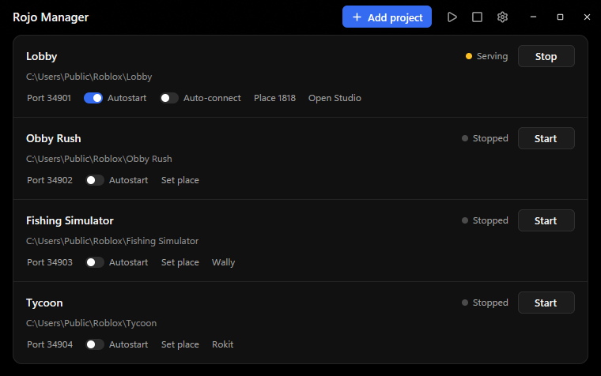

# Rojo Manager

[](https://github.com/lClayk/Rojo-Manager/releases/latest) [](https://github.com/lClayk/Rojo-Manager/releases) [](https://github.com/lClayk/Rojo-Manager/actions/workflows/check.yml) [](LICENSE)

A tray app for Windows and macOS that runs the [Rojo](https://rojo.space) servers for all your Roblox projects, with an MCP server so AI agents can run them too.



- Start, stop, and watch a Rojo server per project, each on its own port, from the window or the tray menu.
- Link a project to its place, open it in Studio with one click, and let Rojo connect on its own.
- Install Rojo, Rokit, Wally, and other tools, and a project's pinned tools and packages.
- Crashed servers restart, failures show as notifications, and app updates install with one click.
- Agents can do all of it through the bundled MCP server, and run Luau in Studio.

Questions, feedback, and release updates are on the [DevForum thread](https://devforum.roblox.com/t/4980026).

## Download and run

**Windows 10 or 11, x64.** Download **RojoManager-1.1.0-windows-x64.zip** from [Releases](https://github.com/lClayk/Rojo-Manager/releases/latest), extract it, and double-click **RojoManager.exe**. There is no installer and no administrator access is needed. The download is not code signed yet, so Windows SmartScreen may block the first run: click **More info**, then **Run anyway**.

**macOS 11 or later (beta).** Download **RojoManager-1.1.0-macos.zip**, open it, and move **Rojo Manager.app** to Applications. It runs in the menu bar. The app is not notarized yet, so macOS blocks the first launch: open **System Settings > Privacy & Security** and click **Open Anyway**.

## Projects

Click **Add project** to add a folder with a `*.project.json` file, make a new project with `rojo init`, or convert a `.rbxl` place into a project (Rojo 7.7 or later). Each project gets a free port. Click **Start**.

- **Set place** links the project to a Roblox place: paste a place ID or link, and **Open Studio** opens it. Type `local` for an unpublished place file the manager builds from the project.
- **Auto-connect** connects Rojo on its own while that place is open in Studio and the server runs.
- **Accept** and **Abort** show when Rojo waits for its first sync to be confirmed, with what accepting would add, change, and remove.
- **Pull** writes what Studio has back into the project's files with `rojo syncback`, for work done in Studio. It lists the files first. Studio's version wins, so files for instances Studio does not have are removed. Needs Rojo 7.7 or later and Lune.
- **Idle close** closes the place's Studio after that many minutes with nothing happening in it. Unsaved changes there are lost. Settings can turn it off for every project and for agents.
- **Show Studio** shows a Studio window that an agent opened hidden.
- A **history icon** restores instances Rojo removed from Studio. The last 20 backups are kept per project.
- **Autostart** starts the server with the manager, and **Sourcemap** keeps `sourcemap.json` current for [luau-lsp](https://github.com/JohnnyMorganz/luau-lsp).
- **Wally**, **Rokit**, and **Aftman** install the project's packages and pinned tools. **Settings > Tools** installs and updates global tools through Rokit.
- **Remove** takes the project off the list and keeps its files, except a local place file the manager built.

The sync preview, Pull, Idle close, and backups need the bridge plugin described under [Agents](#agents).

Closing the window leaves the manager and its servers running in the tray. A dot on the tray icon is yellow while a server runs, green while Studio is connected, and red when a port is taken. **Quit** in the tray menu stops the servers.

## Agents

AI agents can run your Rojo servers, open places in Studio, connect the Rojo plugin, and run Luau in Studio through the MCP server that ships with the app.

1. In **Settings > Agents**, click **Install** next to **Studio plugin with agent bridge**, then restart Studio. Turn off the Creator Store Rojo in Studio so only one Rojo runs.
2. Under **Add to an agent**, click **Claude Code** or **Codex**, or **Other** for the config to paste into any other MCP client.

| Tool | What it does |
| --- | --- |
| `list_projects` | Projects with their server state, port, linked place, and Rojo's status in Studio |
| `rojo_server` | Starts, stops, or restarts a project's server |
| `open_place` | Opens a place in Studio, optionally connecting Rojo, without a window (Windows only), or with an idle close |
| `rojo_session` | Connects or disconnects Rojo, accepts or aborts the first sync, restores backups, and pulls from Studio |
| `lane` | Gives an agent its own copy of a project, with its own server and Studio, for parallel work |
| `server_logs` | Reads a project's recent Rojo output |
| `studio_output` | Reads Studio's Output for an open place |
| `manage_project` | Adds, creates, converts, changes, or removes projects |
| `updates` | Checks for and installs app and bridge updates |
| `app_settings` | Reads or changes the app's settings |
| `get_connected_instances` | Lists the Studio windows the bridge reaches |
| `execute_luau` | Runs Luau in a Studio window with plugin permissions |

Rojo Manager owns every server, so the window always shows what an agent did. Agents reach it through a local API protected by a random token. The bridge is the official Rojo plugin with a [small module](rojo_bridge/RojoManagerBridge.luau) added on your machine, and it talks to the manager on `localhost:34871`.

## Updates and data

The app checks for a newer release on launch and offers **Update now**, which installs it and restarts with the same servers running. Beta versions are GitHub pre-releases and are never offered.

Projects and settings are in `%LOCALAPPDATA%\RojoManager` on Windows and `~/Library/Application Support/RojoManager` on macOS. The app has no account and no analytics. It contacts GitHub for releases and Roblox's public APIs to look up a place you link.

To uninstall, turn off startup in Settings, quit from the tray menu, and delete the application folder and the data folder. On Windows, also delete the **Rojo Manager** shortcut from the Start menu.

## Develop and build

The app is written in Rust, with a native window drawn by [GPUI](https://gpui.rs) and [GPUI Kit](https://gpui-kit.com). On Windows you need [Rust](https://rustup.rs) with the MSVC toolchain and the Windows SDK.

```powershell
cargo test --workspace
cargo build --release --workspace
cargo install cargo-about
.\package.ps1
```

`cargo run -p rojo-manager` runs the app, and `ROJO_MANAGER_DATA_DIR` points it at a separate data folder for testing. On macOS, build for `aarch64-apple-darwin` and `x86_64-apple-darwin`, then run `./package-macos.sh`.

## License

[MIT](LICENSE). Bundled dependencies keep their own licenses, included in the download's `licenses` folder. Rojo Manager is an independent project and is not affiliated with Roblox or the Rojo maintainers.

The files in [`rojo_bridge`](rojo_bridge) modify the Rojo plugin and are licensed under the [MPL-2.0](rojo_bridge/LICENSE), like [Rojo](https://github.com/rojo-rbx/rojo). Neither the app nor this repository contains Rojo. Rojo, its plugin, and Lune are downloaded from their official GitHub releases on your machine.
