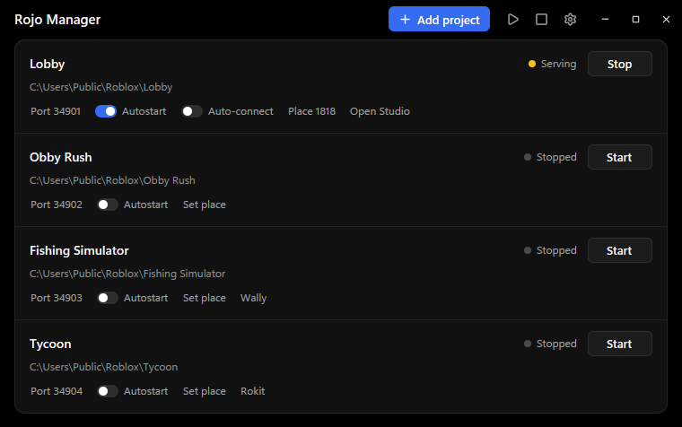

# Rojo Manager

A Windows tray app that runs the [Rojo](https://rojo.space) servers for all your Roblox projects, with an MCP server so AI agents can run them too.



- Start, stop, and watch a Rojo server per project, each on its own port, from the window or the tray menu.
- Link a project to its place, open it in Studio with one click, and let Rojo connect on its own.
- Install Rojo, Rokit, Wally, and other tools, and a project's pinned tools and packages.
- Crashed servers restart, failures show as notifications, and app updates install with one click.
- Agents can do all of it through the bundled MCP server, next to robloxstudio-mcp.

Questions, feedback, and release updates are on the [DevForum thread](https://devforum.roblox.com/t/4980026).

## Download and run

1. Download **RojoManager-0.8.1-windows-x64.zip** from [Releases](https://github.com/lClayk/Rojo-Manager/releases/latest).
2. Right-click the ZIP and choose **Extract All**.
3. Open the extracted `RojoManager` folder and double-click **RojoManager.exe**.

No installation or administrator access is needed. The app adds itself to the Start menu, so Windows search finds it. Keep `ToolInstaller.exe` and `RojoManagerMCP.exe` beside the app. The download is not code signed yet, so Windows SmartScreen may show "Windows protected your PC" on the first run. Click **More info**, then **Run anyway**.

Requires Windows 10 or 11, x64. Other platforms are not currently supported.

## Add a project

Click **Add project** and select a folder containing a `*.project.json` file. You can also select a parent folder to add projects from its immediate subfolders. Each project gets a free port automatically; click the port to change it. Click the name to rename the project (stop its server first), or the folder path to open it. Then click **Start**.

If Rojo is missing, use **Install Rojo** in the warning or open **Settings > Tools**. Install the Studio plugin with its separate button, then connect from that plugin in Roblox Studio.

- **Autostart** starts that project's server when the manager opens.
- **Set place** links the project to a Roblox place. Paste a place ID, game link, or Creator Hub link; an experience link uses its start place. **Open Studio** then opens that place in Roblox Studio, the same as the Creator Hub's Edit button. Clear the place to unlink it.
- **Auto-connect** appears once a place is linked. While that place is open in Studio and the project's server runs, Rojo connects to it on its own, also when you turn Auto-connect on or start the server after opening the place. Disconnecting by hand stays disconnected. Auto-connect also accepts Rojo's initial sync prompt, which applies the project to Studio; turn off **Skip Rojo's sync prompt on auto-connect** in Settings to confirm it yourself. It needs the Rojo bridge plugin described under [Agents](#agents).
- **Launch at Windows startup** starts the manager when you sign in.
- **Keep running in the tray** keeps the manager and servers running when you close the window. Use **Quit** in the tray menu to exit and stop servers started by this session. Closing the window unloads it completely, so the manager uses only a few MB while it runs in the tray; the window loads again when you open it.
- The **tray menu** starts or stops each project's server, opens linked places in Studio, and has **Start All Servers** and **Stop All Servers**. A dot on the tray icon shows the servers' state, in the window's colors: yellow while one runs, green while Studio is connected, red when a port is taken. Turn it off with **Show server status on the tray icon**.
- **Notify when a server fails** shows a Windows notification while the window is closed, for example when a crashed server is not restarted or another application takes a project's port.
- **Restart servers that crash** starts a server again when it exits unexpectedly, up to 3 times a minute.
- **Remove** removes a project from the list. It keeps all project files.
- **Existing** means a Rojo server for this project is already running outside this manager session. **Port busy** means another application, or a Rojo server for a different project, owns the port. **Kill** names that process and asks before force-closing it.

## Tools and packages

Project buttons appear only when their manifests exist. Their visibility can be changed in Settings.

| Button | What it does |
| --- | --- |
| Wally | Installs the packages in `wally.toml`, after installing declared project tools if needed. |
| Rokit or Aftman | Installs the pinned tools in `rokit.toml` or `aftman.toml`. Rokit can read existing Aftman configurations. |
| Install or update in Settings > Tools | Installs or updates a global tool through Rokit. Project version pins stay unchanged. |

StyLua and Selene are optional conveniences. Installing them does not add formatting or linting to this app. Lune is also used to build the Rojo bridge plugin described under [Agents](#agents).

Installation opens a terminal for progress and any tool trust prompts. A click starts the process; confirmation may still be needed. Background status and version checks run without terminal windows. Tool downloads require internet access and may be limited by GitHub's rate limits.

The Rojo update warning checks the global version. A project can deliberately pin an older version; use its tool button to install that version. The manager does not upgrade project pins automatically.

## Agents

AI agents can run your Rojo servers, open places in Studio, and connect or disconnect the Rojo plugin, all through the MCP server that ships with the app (`RojoManagerMCP.exe`). It works next to [robloxstudio-mcp](https://github.com/Chrrxs/robloxstudio-mcp), which agents keep using for everything inside Studio.

1. Set up robloxstudio-mcp by following its README, if you have not already.
2. In **Settings > Agents**, click **Install** next to **Studio plugin with agent bridge**, then restart Studio. If you also have the Creator Store Rojo, turn it off in Studio (**Plugins > Manage Plugins**) so only one Rojo runs.
3. Under **Add to an agent**, click **Claude Code** or **Codex**. The app runs that agent's own `mcp add` command, so `rojo-manager` is there in every new session. If the agent's command line tool is not installed, the app shows the command to run instead. For any other MCP client, click **Other** for the config to paste and where common clients keep their config file.

| Tool | What it does |
| --- | --- |
| `list_projects` | Projects with server state, port, linked place, and Rojo status in any Studio that has the place open |
| `rojo_server` | Starts, stops, or restarts a project's Rojo server |
| `open_place` | Opens a project's place, or any place ID or link, in Studio. Passing both a project and a place links them. `connect_rojo` also starts the server and connects Rojo |
| `rojo_session` | Connects or disconnects Rojo in an open place, reads its status, or accepts or aborts Rojo's initial sync confirmation |
| `server_logs` | Reads a project's recent Rojo output, such as sync errors or why the server stopped |
| `manage_project` | Adds a project folder, or every project in a parent folder; changes a project's name, port, autostart, auto-connect, or linked place; or removes it from the list |
| `app_settings` | Reads or changes the app's own preferences. Agents are told to change these only when asked |

Rojo Manager keeps ownership of every server, so the window always shows what an agent did. If it is not running, the MCP server starts it in the tray. The agent and the window talk through a local API that needs a random token stored in `%LOCALAPPDATA%\RojoManager\control.json`. Browsers cannot reach it.

Rojo itself has no way for other plugins to control it, so the bridge plugin is the official Rojo plugin with a small addition. Every few seconds the bridge also tells Rojo Manager on `localhost:34871` which server Rojo is connected to, so the window shows Connected only for a real session, and asks whether a running project auto-connects to the open place. That port answers without a token, but only with a port number for a place ID. The bridge also reports there how many Rojo plugins Studio is running, so Settings can warn when the Creator Store Rojo is still on beside it. When an app update brings a newer bridge, the window shows a banner to update it. The installer downloads `Rojo.rbxm` for your installed Rojo version from Rojo's GitHub releases. It then uses Lune to add the [bridge module](rojo_bridge/RojoManagerBridge.luau) and two hook lines, and saves the result as `RojoManagerRojo.rbxm` in Studio's Plugins folder. In Edit mode the bridge exposes `CoreGui.RojoManagerBridge`, which plugin code can call but game scripts cannot. Updating Rojo from **Tools** rebuilds the bridge for the new version. If Rojo was updated some other way, Settings says the bridge no longer matches; click **Update** there.

## App updates

Rojo Manager checks its own version on launch. When a newer stable release exists, a banner offers **Update now** and **What's new**; the tray menu offers the update too. Settings shows the installed app version and has a **Check now** button. Automatic app checks can be disabled separately from Rojo tool checks.

Beta versions are published as GitHub pre-releases. The app never offers them; download one from [Releases](https://github.com/lClayk/Rojo-Manager/releases) to try it. A beta build offers the full release of its version once that is out.

**Update now** downloads the release's ZIP, checks it against the SHA-256 digest GitHub lists for it when there is one, and replaces the files in the application folder. The manager then restarts, starting again the servers that were running. Your settings stay in local app data.

To update by hand instead, download and extract the new ZIP, quit the old manager from its tray menu, then replace the old application folder and reopen it. Keep `ToolInstaller.exe` and `RojoManagerMCP.exe` with the app. If you move the app to a different location, turn Windows startup off and on again to update its startup entry.

The updater reads public GitHub releases without signing in or storing credentials. If releases are private or the network fails, Settings reports that the check failed and offers the release page instead of claiming the app is up to date.

## Saved data

Projects and settings are stored in `%LOCALAPPDATA%\RojoManager\config.json`, outside the application folder. A fresh profile opens with an empty project list. While the app runs, `control.json` beside it holds the port and token of the local agent API; it is removed on exit. The app also listens on `localhost:34871` for the bridge's session reports, its auto-connect question, and its count of running Rojo plugins. Logs stay in memory and are discarded when the app exits. Installer requests and results use temporary folders and are removed after completion while the manager is open.

The app has no account, analytics, or credential store. It checks GitHub for Rojo Manager and Rojo releases, probes local Rojo servers, and asks Roblox's public APIs for a place's experience when you set one. Tool installers make their own network requests and manage their own configuration. Do not include your settings file or project logs when sharing a bug report without checking them for private paths and output.

To reset the app, quit it and move or delete its settings file. To uninstall, disable Windows startup in Settings, quit, and delete the extracted application folder and the **Rojo Manager** shortcut in `%APPDATA%\Microsoft\Windows\Start Menu\Programs`. Remove the settings folder too if you want to erase saved projects. Tools installed through Rokit remain installed.

## Develop and build

The app is written in Rust. The window is native, drawn on the GPU with [GPUI](https://gpui.rs) and [GPUI Kit](https://gpui-kit.com). The tray app runs the engine without a window; the window is a second process (`RojoManager.exe --window`) that it starts on demand and talks to over stdin and stdout, so closing the window returns all of its memory. You need [Rust](https://rustup.rs) with the MSVC toolchain and the Windows SDK (Visual Studio Build Tools).

```powershell
cargo test --workspace
cargo build --release --workspace
cargo install cargo-about
.\package.ps1
```

The ZIP and SHA-256 checksum are written to `dist`. `cargo run -p rojo-manager` runs the app. Tests use temporary settings and never touch the real Windows startup entry. Set `ROJO_MANAGER_DATA_DIR` to a separate folder when testing an isolated app profile. CI runs the same steps and checks the packaged executables with `tests/check_bundle.py`.

## License

[MIT](LICENSE). Bundled dependencies retain their own licenses, included in the download's `licenses` folder. Rojo Manager is an independent project and is not affiliated with Roblox, the Rojo maintainers, or robloxstudio-mcp.

The files in [`rojo_bridge`](rojo_bridge) modify the Rojo plugin and are licensed under the [MPL-2.0](rojo_bridge/LICENSE), like [Rojo](https://github.com/rojo-rbx/rojo). Neither the app nor this repository contains Rojo or robloxstudio-mcp. Rojo, its plugin, and Lune are downloaded from their official GitHub releases on your machine. robloxstudio-mcp is installed by its own npm package.
